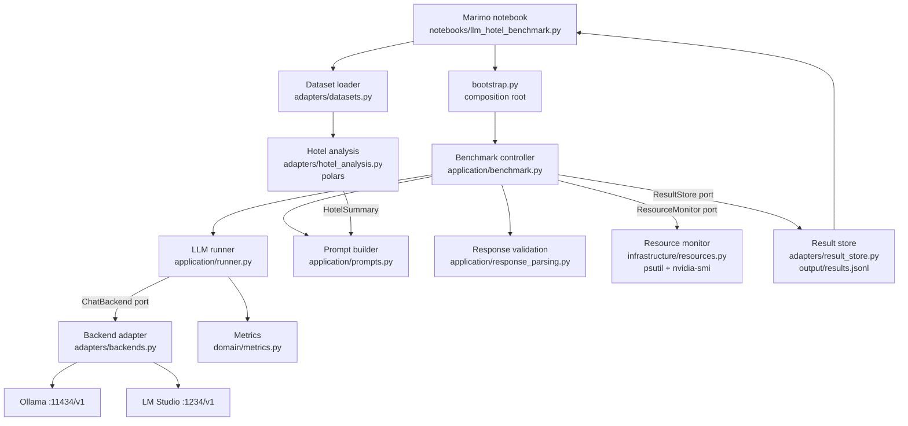

# Architecture

The project follows Clean Architecture. Dependencies point inward; this is enforced by
`import-linter` (`lint-imports`).

## Layers

| Layer | Modules | Rule |
|---|---|---|
| `domain` | `models.py`, `metrics.py`, `tasks.py`, `errors.py` | frozen dataclasses and pure functions; imports nothing else |
| `application` | `ports.py`, `runner.py`, `benchmark.py`, `prompts.py`, `response_parsing.py` | use cases; imports `domain` only; no dataframes, HTTP or OS calls |
| `adapters` | `backends.py`, `datasets.py`, `hotel_analysis.py`, `result_store.py` | HTTP, CSV, polars, JSONL |
| `infrastructure` | `resources.py` | psutil, `nvidia-smi` subprocess |
| root | `bootstrap.py` | wires concrete implementations; the only place that knows all layers |

## Component responsibilities

* **Marimo notebook** – widgets, configuration, execution control, charts, result presentation. No business logic.
* **Benchmark controller** (`application/benchmark.py`) – expands a `BenchmarkPlan` (backends x models x runs x prompts) into requests, marks the first request per model as cold, starts/stops the resource monitor, validates responses, persists each result immediately, reports progress via a callback.
* **LLM runner** (`application/runner.py`) – performs one streamed request through the `ChatBackend` port with an injectable clock and returns raw timings and text; never raises for backend failures.
* **Backend adapter** – OpenAI-compatible `/v1` HTTP client: model listing, connectivity status, SSE streaming with usage. Translates transport errors into `BackendError`.
* **Dataset loader** – reads CSV, hashes the file, validates emptiness and required columns, returns `DatasetInfo` or a `DatasetError`.
* **Hotel analysis** – deterministic overall / direct / agent cancellation statistics and breakdowns over the dimensions that exist in the data.
* **Prompt builder** – turns a `HotelSummary` into a versioned JSON-output prompt; the CSV is never sent.
* **Response validation** – extracts and validates the JSON answer; invalid answers are kept raw and marked, never raised.
* **Metrics** (`domain/metrics.py`) – TTFT, total time, tokens/s from timestamps and token counts.
* **Resource monitor** – background sampler for system RAM and GPU VRAM (before / after / peak); unavailable sources yield `None`.
* **Result store** – append-only JSONL, reads schema v1 and v2 rows.

## Ports

`ChatBackend`, `ResourceMonitor`, `ResultStore` (`application/ports.py`). Tests use fakes of these ports.

## Extension points

Another OpenAI-compatible server = one more `Backend(name, base_url)` entry in `bootstrap.py`.
Another dataset schema = a different `ColumnMapping`.
