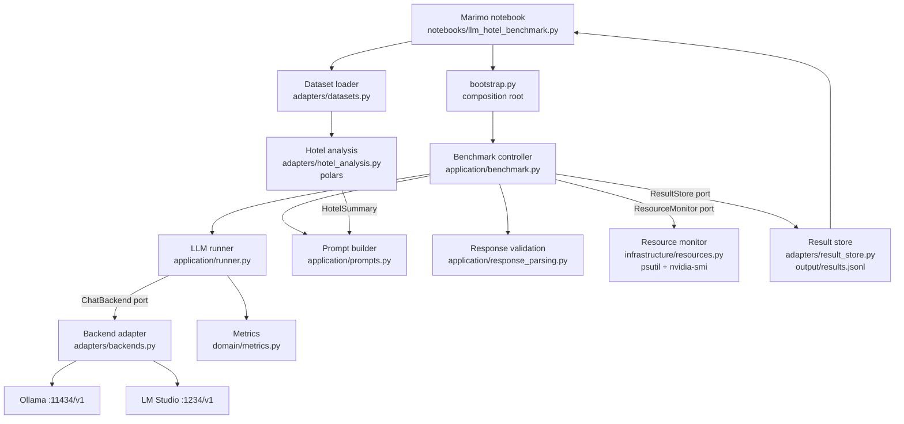

# Architecture

The project follows Clean Architecture. Dependencies point inward; this is enforced by
`import-linter` (`lint-imports`).

## Layers

| Layer | Modules | Rule |
|---|---|---|
| `domain` | `models.py`, `metrics.py`, `tasks.py`, `errors.py`, `service.py` | frozen dataclasses and pure functions; imports nothing else |
| `application` | `ports.py`, `runner.py`, `benchmark.py`, `prompts.py`, `response_parsing.py`, `run_service.py`, `model_service.py`, `delivery.py`, `payload.py` | use cases; imports `domain` only; no dataframes, HTTP or OS calls |
| `presentation` | `api.py` | the HTTP API of the benchmark service (Starlette); controllers only, no rules |
| `adapters` | `backends.py`, `datasets.py`, `hotel_analysis.py`, `result_store.py`, `web_result_sender.py`, `pending_store.py`, `hotel_input.py`, `model_catalog.py`, `ollama_info.py`, `ollama_models.py` | HTTP, CSV, polars, JSONL, files |
| `infrastructure` | `resources.py`, `machine.py`, `worker.py` | psutil, `nvidia-smi` subprocess, the background thread |
| root | `bootstrap.py` | wires concrete implementations; the only place that knows all layers |

## Component responsibilities

* **Marimo notebook** – widgets, configuration, execution control, charts, result presentation. No business logic.
* **Benchmark controller** (`application/benchmark.py`) – expands a `BenchmarkPlan` (backends x models x runs x prompts) into requests, marks the first request per model as cold, starts/stops the resource monitor, validates responses, persists each result immediately, reports progress via a callback.
* **LLM runner** (`application/runner.py`) – performs one streamed request through the `ChatBackend` port with an injectable clock and returns raw timings and text; never raises for backend failures.
* **Backend adapter** – OpenAI-compatible `/v1` HTTP client: model listing, connectivity status, SSE streaming with usage. Translates transport errors into `BackendError`.
* **Dataset loader** – reads CSV, hashes the file, validates emptiness and required columns, returns `DatasetInfo` or a `DatasetError`.
* **Hotel analysis** – deterministic overall / direct / agent cancellation statistics and breakdowns over the dimensions that exist in the data.
* **Prompt builder** – turns a `HotelSummary` into a versioned JSON-output prompt; the CSV is never sent.
* **Response validation** – extracts and validates the JSON answer; invalid answers are kept raw and marked, never raised.
* **Metrics** (`domain/metrics.py`) – TTFT, total time, tokens/s from timestamps and token counts.
* **Resource monitor** – background sampler for system RAM and GPU VRAM (before / after / peak); unavailable sources yield `None`.
* **Result store** – append-only JSONL, reads schema v1 and v2 rows.

## Benchmark service (MIL-002, ADR-0001)

`presentation/api.py` starts runs through `application/run_service.py` (a queue of two waiting runs, one run at a time). The worker thread (`infrastructure/worker.py`) calls `RunService.tick`: due delivery attempts first, then the next run. A finished run becomes the body of `openapi/benchmark-contract.yaml` (`application/payload.py`), is written to `pending/` on the volume (`adapters/pending_store.py`) and posted to the web API (`adapters/web_result_sender.py`) with a retry of 5 s doubling until 15 minutes after the run ended. `application/model_service.py` adds and deletes models (ADR-0005): `POST /models` queues one pull at a time and returns at once, a background thread runs it through `adapters/ollama_models.py` (`/api/pull`), and the progress of the last 20 pulls is kept in memory; `DELETE /models/{name}` deletes through `RunService.delete_if_unused`, which holds the lock that queues runs, so a model that a queued or running run names is refused. Start the service with `uvicorn --factory nfbench.bootstrap:create_service_app`; settings are `NFBENCH_*` environment variables (`ServiceSettings`).

## Ports

`ChatBackend`, `ResourceMonitor`, `ResultStore`, `ModelCatalog`, `MachineInspector`, `ResultSender`, `PendingResultStore`, `BenchmarkExecutor` (`application/ports.py`). Tests use fakes of these ports.

## Extension points

Another OpenAI-compatible server = one more `Backend(name, base_url)` entry in `bootstrap.py`.
Another dataset schema = a different `ColumnMapping`.
