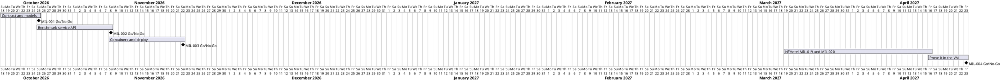

# Project Plan

## Metadata
| Key | Value |
| --- | --- |
| ID | PP-001 |
| CrossReference | [BC-001], [SA-001], [MIL-001], [MIL-002], [MIL-003], [MIL-004], [MIL-005], [MIL-006] |
| Language | en |
| Domain | it |

## Version History
| Date | Status | Author | Reviewer | Change | Commit |
| --- | --- | --- | --- | --- | --- |
| 2026-10-18 | Proposed | Claude (AI) | S04 | Initial version | [ed03191] |
| 2026-10-19 | Accepted | Claude (AI) | AI at the request of S04, not independent | Added MIL-005 (models added and deleted by an administrator); accepted after RC-018 Go | [b4a507d] |
| 2026-10-19 | Accepted | Claude (AI) | AI at the request of S04, not independent | Added MIL-006 (list the runs and the model downloads); accepted after RC-022 Go | [ced9a43] |

---

## Purpose

Schedules the four phases that turn the benchmark notebook into a service on the Proxmox VM that reports to the NFHotel web application. The plan spans two repositories: this one holds the benchmark service, and the NFHotel repository holds the results API, the table, the pages and the start button (its milestones MIL-019 and MIL-020).

## Planning Assumptions

- Week 1 starts 2026-10-18.
- Phase length: one to two weeks. The last phase waits for the two NFHotel milestones, which follow NFHotel MIL-018 in that plan (2027-03-19), so the plan ends on 2027-04-23.
- S04 (Valdamar) reviews and approves; in supervised mode the user reviews the artifacts and the AI does not stand in for S04.

## Gateway Schedule

| Gateway | Document | Window | Decision date | Owner | Stories | Main deliverable | Milestone |
| --- | --- | --- | --- | --- | --- | --- | --- |
| Contract and models | [MIL-001] | 2026-10-18 to 2026-10-25 | 2026-10-25 | S01 | none | ADR-0001 (contract), ADR-0002 (models), OpenAPI file | none yet |
| Benchmark service API | [MIL-002] | 2026-10-25 to 2026-11-08 | 2026-11-08 | S01 | none | HTTP API, run controller, result sender, tests with fakes | none yet |
| Containers and deploy | [MIL-003] | 2026-11-08 to 2026-11-22 | 2026-11-22 | S01 | none | Dockerfile, Compose with Ollama, model-pull script, smoke test | none yet |
| Manage models | [MIL-005] | 2026-10-19 to 2026-10-26 | 2026-10-26 | S01 | none | ADR-0005, pull and delete endpoints, progress of a pull, tests with a fake Ollama | none yet |
| List runs and downloads | [MIL-006] | 2026-10-19 to 2026-10-26 | 2026-10-26 | S01 | none | ADR-0006, GET /runs and GET /models/pulls, tests with fakes | none yet |
| Prove it in the VM | [MIL-004] | 2027-04-16 to 2027-04-23 | 2027-04-23 | S01 | none | One full run from the back office stored and read in the admin page | none yet |



## Scope Coverage

| Business Case scope item | Gateway |
| --- | --- |
| Dockerfile and Compose for the benchmark service and Ollama, env files | MIL-003 |
| Model-pull script and the list of models (ADR) | MIL-001 (list), MIL-003 (script) |
| HTTP API on the benchmark service guarded by a service token, and its client in the web application | MIL-002 (API); NFHotel MIL-020 (client) |
| Results API, table and admin page in the web application | NFHotel MIL-019 |
| ADR for the contract between the two services | MIL-001 |
| Endpoints to pull and delete models, and their client and page in the web application | MIL-005 (service); NFHotel MIL-020 (client and page) |
| Endpoints to list the runs and the downloads, and the live view in the web application | MIL-006 (service); NFHotel MIL-020 (client and page) |
| Tests and a smoke test in the VM | MIL-002, MIL-003, MIL-004 |

## Dependencies

```
MIL-001 -> MIL-002 -> MIL-003 -> MIL-004
MIL-001 -> NFHotel MIL-019 -> NFHotel MIL-020 -> MIL-004
```

MIL-006 follows MIL-005 and adds two reads to the contract (ADR-0006); the live view of NFHotel MIL-020 is built against it.

MIL-005 follows MIL-002 (the service API) and changes the contract of MIL-001 by a new version of the OpenAPI file (ADR-0005); the model page of NFHotel MIL-020 is built against it.

NFHotel MIL-019 and MIL-020 build against the contract of MIL-001, so a No-Go on MIL-001 moves them and MIL-004. A No-Go on a NFHotel milestone moves only MIL-004.

## Plan Risks

| Risk | Impact | Mitigation |
| --- | --- | --- |
| The contract changes after the web side is built | Rework in both repositories | ADR-0001 and the OpenAPI file are reviewed before either side is coded; a change is a new ADR |
| The NFHotel milestones are late | MIL-004 waits | MIL-002 and MIL-003 are proved with fakes and a missing web API, so they do not wait |
| Two repositories drift in the result schema | Wrong numbers in the admin page | A schema test on both sides against the same OpenAPI file |
| The VM is too small for the chosen models | A run does not finish | ADR-0002 sizes the list; a smaller list is a new version of the ADR, not a code change |

## Open Issues

- The final model list depends on the memory of the VM (ADR-0002).
- Whether the VM has a GPU is not known; results name the machine either way.
- The `framework/qc/` submodule of this repository cannot be cloned from here (private host); reviews read the checklists from the NFHotel copy until it is initialised.

---

[BC-001]: ./business-case.md
[SA-001]: ./stakeholder-analysis.md
[MIL-001]: ./milestones/mil-001-contract-and-models.md
[MIL-002]: ./milestones/mil-002-benchmark-service-api.md
[MIL-003]: ./milestones/mil-003-containers-and-deploy.md
[MIL-004]: ./milestones/mil-004-prove-it-in-the-vm.md
[MIL-005]: ./milestones/mil-005-manage-models.md
[MIL-006]: ./milestones/mil-006-list-runs-and-downloads.md
[ed03191]: https://github.com/NF-Hotel/notebook-benchmark/commit/ed0319185c76fb34b5933731b3889b267c557224
[b4a507d]: https://github.com/NF-Hotel/notebook-benchmark/commit/b4a507d7062e24151cfc8aaa175c15d324dd1317
[ced9a43]: https://github.com/NF-Hotel/notebook-benchmark/commit/ced9a43ed010056f56f5905fb2b62b399b7e9e42
