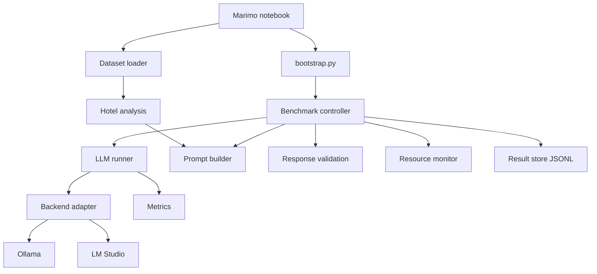

# Architecture

Clean Architecture; dependencies point inward, enforced by `import-linter`. Details: `ARCHITECTURE.md` in the repo.

| Layer | Modules |
|---|---|
| `domain` | models, metrics, tasks, errors (pure) |
| `application` | ports, runner, benchmark controller, prompts, response parsing |
| `adapters` | backends (HTTP), datasets, hotel analysis (polars), result store |
| `infrastructure` | resource monitoring (psutil, nvidia-smi) |
| `bootstrap.py` | composition root |

The notebook holds UI only. There is no HTTP API.
